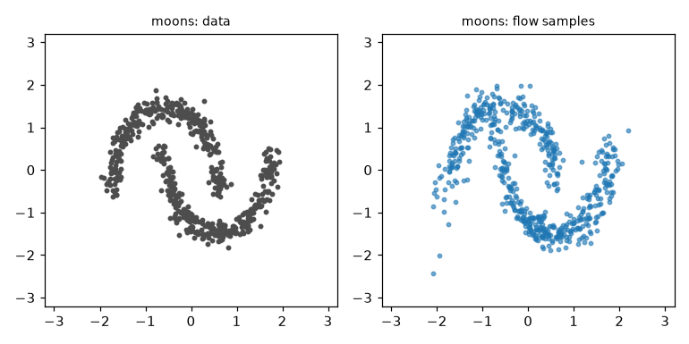
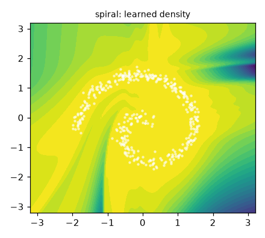

# realnvp-numpy

A RealNVP normalizing flow built with nothing but NumPy. The coupling layers
use small MLPs with hand-written backprop, so there is no autograd library
anywhere in the stack. Training maximizes exact likelihood, which is the
main thing a flow buys you over a GAN or a VAE: the loss is comparable
across models, not just a proxy.

## Results

Both datasets (two moons and a spiral, 2000 points each, 600 held out)
trained for 12,000 steps with four coupling layers. Held-out negative log
likelihood, against a diagonal Gaussian fit on the same training data:

| dataset | flow NLL | Gaussian NLL |
|---------|----------|--------------|
| moons   | 1.758    | 2.834        |
| spiral  | 1.716    | 2.846        |

600 samples per model were also scored against the held-out points with the
same two checks the diffusion repo uses: 1-NN label accuracy, where 0.5
means the two samples are hard to tell apart, and RBF MMD.

| dataset | 1-NN | MMD |
|---------|------|-----|
| moons   | 0.499 | 0.0009 |
| spiral  | 0.537 | 0.0005 |




The density plots show where the model puts its mass: high on the manifold,
with the kind of corner artifacts you expect from a small flow pushed to the
edge of its range.

## Layout

- src/realnvp_numpy/net.py: the MLP with tanh activations and manual
  backprop
- src/realnvp_numpy/flow.py: affine coupling layers, forward and inverse,
  plus the exact log determinant
- src/realnvp_numpy/train.py: Adam and a weight EMA
- src/realnvp_numpy/metrics.py: 1-NN separability and RBF MMD
- src/realnvp_numpy/train_driver.py: trains both runs and writes
  results.json, sample grids and density plots to assets/

## Usage

```
pip install -e .
python src/realnvp_numpy/train_driver.py
python -m pytest tests/
```

Six tests cover the inverse round trip, the log determinant against a
numeric Jacobian, gradient checking, mask alternation and sample sanity.
